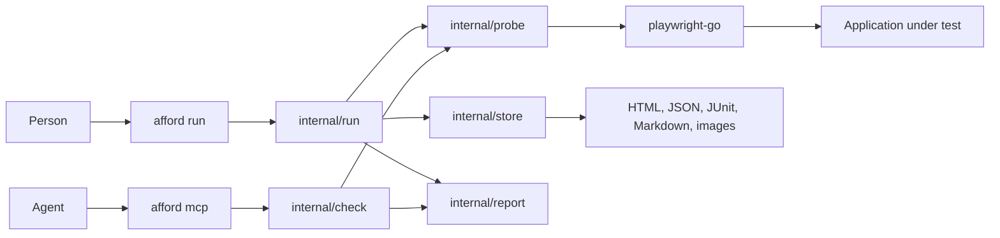
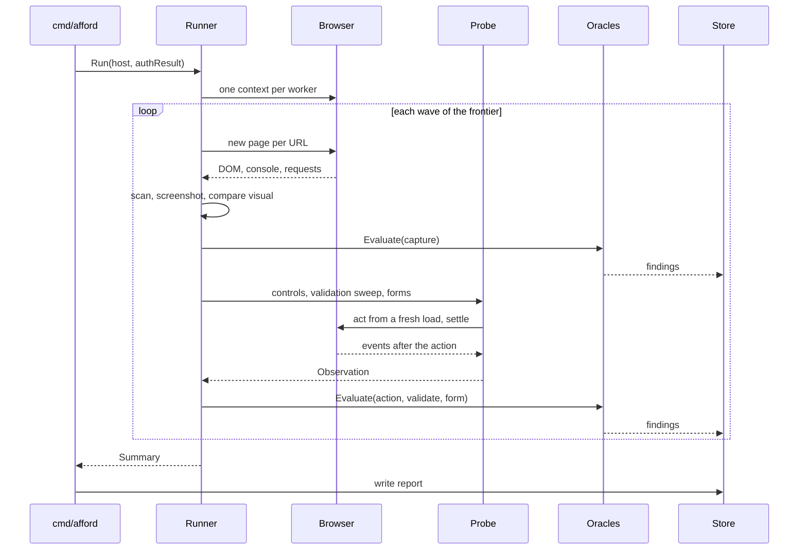

# afford architecture

This document describes how afford works inside: the components, the data that
moves between them, the algorithms that decide what counts as a defect, and the
constraints that shaped those choices. It assumes you have read the user guide or
know what the tool does.

## Scope

afford is a deterministic browser crawler with an opinion about evidence. It
walks a running web application, exercises the affordances on each page, and
writes findings that a person or an agent can check without rerunning the tool.
It is not a test framework, a load generator, or an accessibility auditor.

The design goal that constrains everything else: **a finding must be reproducible
and attributable**. That rules out random payloads, hidden heuristics that cannot
be explained, and any rule that reports a page-level symptom as a control-level
defect.

## System context



Two entry points share one checking engine. The command line runs a wave crawl.
The MCP server checks one page, or a bounded crawl, on request. Neither entry point
has a rule the other lacks; a check added to one path is added to both or it is
not finished.

## Component map

| package | responsibility | depends on |
|---|---|---|
| `internal/model` | Domain types, severity, the finding catalogue, finding identity. | standard library |
| `internal/config` | TOML loading, defaults, validation, permission predicates. | `model` |
| `internal/discover` | URL normalization, route templates, scope globs, link dispositions, the DOM scan JavaScript. | `config`, `model`, playwright-go for the `Page` type |
| `internal/payloads` | Field classification, valid values, payload batteries, destructive vocabulary. | `model` |
| `internal/sanitize` | Masks credential-looking query values in recorded URLs. | standard library |
| `internal/browser` | Playwright host, browser contexts, event collector, settling, screenshots. | `config`, `model`, `sanitize`, playwright-go |
| `internal/auth` | Credential resolution, form login, storage state. | `browser`, `config`, `discover` |
| `internal/probe` | One action or one form, returning an observation. Drives the browser. | `browser`, `config`, `discover`, `model`, `payloads`, `sanitize`, `uploads` |
| `internal/oracles` | Observation to findings. No browser access, no severity decisions outside the catalogue. | `model` |
| `internal/uploads` | File fixture resolution and synthesized sample files. | `config`, `model` |
| `internal/visual` | Baseline store and pixel diff. | `config` |
| `internal/check` | Single-page checker: context, capture, probes, popup and visual findings. | `auth`, `browser`, `config`, `discover`, `model`, `oracles`, `payloads`, `probe`, `sanitize`, `visual` |
| `internal/run` | Wave crawl, link audit, findings orchestration, summary. | `check`'s siblings, `store`, `report`, `visual` |
| `internal/audit` | Page-level oracles that need the live page: rendered text, broken images, rejections, embedded axe-core, the Tab pass. Findings only; severity comes from the catalogue. | `model`, `sources`, playwright-go |
| `internal/pass` | The page capture shared by `run` and `check`, so the two cannot diverge. Calls `audit`. | `audit`, `browser`, `discover`, `model`, `oracles`, `probe` |
| `internal/routes` | Sitemap, robots, Next manifest and configured routes, resolved against the base origin and dropped if they leave it. | `config` |
| `internal/fixtures` | Operator setup and teardown commands with `AFFORD_RUN_ID`. | `config` |
| `internal/history` | `history.jsonl`: one line per run, previous-run lookup, delta text. | `model` |
| `internal/sarif` | SARIF 2.1.0 writer. | `model` |
| `internal/gate` | Confirm, policy, suppression and baseline layers; decides which findings gate. | `config`, `model` |
| `sources` | Archived third-party code (axe-core) embedded with `go:embed`, and `INDEX.md`. | none |
| `internal/store` | Append-only JSONL log and in-memory replay. | `model` |
| `internal/report` | HTML, JSON, JUnit and Markdown writers. | `model`, `store` |
| `internal/mcpserver` | MCP tools, lazy browser and session, tool schemas. | `check`, `run`, `report`, `store`, `auth`, `browser` |

The dependency direction points inward. `model` and `config` know nothing about
the browser. `oracles` knows nothing about Playwright. `report` reads the store
and the model. Only `cmd/afford` imports both `run` and `mcpserver`.

## Domain model

`model.ScanResult` is the page as the DOM described it: title, body length, node
count, overflow, `[]Element` and `[]FormSpec`.

`model.Element` is one interactive element: tag, role, accessible name, a
fingerprint (`tag|role|name`), an occurrence index for duplicate fingerprints, the
declared type, disabled and required flags, visibility, rectangle, containing form,
select options, label count, and the input attributes that matter for validation
(`min`, `max`, `maxlength`, `pattern`, `autocomplete`).

`model.Observation` is what one probe heard and saw: before and after URLs, status,
navigation flag, console errors and warnings, page errors, dialogs, requests,
effect, action error, occlusion, popup results, duration, and an untyped `Extra`
map for facts an oracle needs (overflow, text sample, upload error, popup URLs).

`model.Finding` is the product: code, severity, title, rationale, page URL,
element label, probe kind, payload, evidence lines, structured detail, `also_on`
and `occurrences`.

`model.Page`, `model.LinkRecord` and `model.PopupResult` describe crawled pages,
not-followed links, and popups captured from a control.

`model.Summary` carries run metadata, coverage counters, severity counts, the list
of things not tested, and whether visual comparison was enabled.

## Run lifecycle



The crawler is breadth-first in waves. Every URL in the current wave is visited
concurrently, one task per URL, with a pool of browser contexts sized by
`[limits] concurrency`. URLs discovered during a wave form the next wave. The
frontier carries each URL's depth; a discovered link is enqueued at `depth + 1`.
This matters: an earlier version hardcoded depth zero, so every page claimed depth
zero, the depth budget never applied, and the deep-link check could not fire.

Before the first wave, `Runner.Run` authenticates once, then creates one
`BrowserContext` per worker from the same storage state. Workers never share a
context, so cookies and local storage cannot interleave between pages being probed
at the same time. The store serializes its writes with a mutex.

## Crawl and discovery

A URL is normalized before it is compared or stored: the fragment is dropped,
tracking parameters (`utm_*`, `gclid`, `fbclid`, `_rsc` and similar) are removed,
the query is sorted, duplicate slashes are collapsed, and a trailing slash is
removed except at the root. Two spellings of the same page compare equal.

A route template replaces identifier-shaped path segments with `{id}`. UUIDs,
integers, long hex strings and ISO dates qualify. The template governs two things:
the instance cap, so `/orders/1` and `/orders/2` do not consume the whole page
budget, and the visual baseline key.

Scope is a pair of glob lists matched against the path. `**` crosses segments,
`*` does not. The scheme and host must match the base URL unless the host appears
in `allow_hosts`. Exclusion wins over inclusion.

Every anchor the scan returns is classified once by `discover.LinkDisposition`:

| disposition | meaning |
|---|---|
| `followed` | In scope. Enqueued at the next depth. |
| `excluded` | Matches an exclude glob, or fails the include globs. |
| `off_origin` | Different host, different scheme, or both. |
| `empty` | Empty href or `#`. |
| `javascript` | `javascript:` pseudo-link. |
| `mail`, `tel` | Addresses, not pages. |
| `invalid` | Could not be resolved or parsed. |

Non-followed links are stored with their source page and reason. Excluded and
off-origin links also produce `E_OUT_OF_SCOPE`, merged across pages.

Budgets are enforced at enqueue time: page count, depth, and instances per
template. When a budget stops a URL, the reason is counted and appears in the
report's not-tested list. A crawl that silently stops at 200 pages is a crawl
nobody can interpret.

## The DOM scan

`discover.ScanJS` runs once per page as a single `page.Evaluate` and returns one
JSON object. A single round trip keeps the inventory internally consistent; two
evaluations can disagree if the page changes between them.

The selector set covers `a[href]`, `button`, `input`, `select`, `textarea`,
`summary`, ARIA roles that imply interactivity, `contenteditable` and inline
`onclick`. Hidden inputs are skipped. Each element gets:

- a fingerprint from tag, role and accessible name, plus an occurrence index, so
  two buttons named "Save" are distinguishable;
- a `data-afford-idx` attribute stamped into the live DOM, which is how a probe
  addresses the exact element it inventoried;
- the bounding rectangle, form membership, label count and select options.

The accessible name follows a short ladder: `aria-label`, `aria-labelledby`,
associated `<label>` elements, then visible text, value, placeholder or title.

A probe re-scans after its fresh navigation and finds the element by fingerprint
and occurrence, not by index, because the index can shift when the page changes.
The re-scan stamps a new index, and the probe clicks that. If no element matches,
the probe reports `E_CONTROL_ERROR` instead of clicking whatever now sits at that
position.

## Probing

Each control probe starts from a fresh navigation to the page URL, then settles.
This is deliberate: a page mutated by nine previous clicks is not the page the
inventory described. Fresh loads cost time and buy attributable evidence.

After settling, the probe records a baseline snapshot of the event collector. It
then acts, settles again, and reports only the events that appeared after the
baseline. Load-time exceptions therefore belong to the capture pass, not to every
control on the page. Without this, one throwing page reported a client error for
every button on it.

The action depends on the control:

| control | action |
|---|---|
| Link or button | Click with the probe timeout. |
| Checkbox or radio | Check. |
| Select | Choose the first enabled, non-empty option. |
| Range | Fill a value inside the declared bounds. |
| File input | Attach a fixture or a synthesized file. |
| Text-like input | Not clicked here; handled by the validation sweep. |

Before clicking, the probe checks whether another element covers the control's
center point after scrolling it into view. A control a user cannot hit is
reported as `E_OCCLUDED` rather than being clicked by synthetic means.

The effect is classified by precedence:

1. `navigated` when the normalized URL changed;
2. `dialog` when a native dialog was dismissed;
3. `popup` when a new tab appeared;
4. `dom` when the DOM signature changed;
5. `network` when requests were observed;
6. `none` when nothing observable happened.

A `none` effect on an enabled button is `E_DEAD_CONTROL`. Links are exempt because a
dead link has its own check. The DOM signature is an FNV-1a hash over the body
text, the node count, and each element's class name plus `aria-expanded`,
`hidden`, `open` and `aria-selected`. Hashing `innerHTML` would be more sensitive
and would also fire on every animation frame and timestamp.

Controls whose names indicate deletion or another irreversible effect are not
acted on unless the operator granted that class. The probe still inventories them,
and the report says they were skipped and which flag would allow them.

### Validation sweep

Inputs are filled without navigating. For each text-like control, the payload
battery runs through fill, blur and a short wait, with the collector and overflow
state marked before each payload. A payload that produces a new exception, console
error, failed request, dialog or horizontal overflow is recorded as an anomaly with
that payload's label and value. The original value is restored between payloads.

This sweep does not assert that the app validates correctly. It hunts for crashes,
noise and layout breakage caused by input, which is what a browser can decide
without a specification. The battery is derived from the field's declared type and
constraints, so an email field gets `not-an-email` and a number field gets `abc`,
a value below `min` and a value above `max`.

### Forms

A form is probed in up to two modes. The invalid mode runs only when a visible
required field exists: it clears the required text fields and submits. If the
submission navigates or receives a 2xx on a mutating method, the browser's own
required-fields check was bypassed, and the form is reported with
`E_VALIDATION_NOT_ENFORCED`. The valid mode fills every control with a value the
field advertises as acceptable, then submits.

A submission counts as accepted when the URL changed or a `POST`, `PUT`, `PATCH` or
`DELETE` returned below 400. A 5xx in either mode is a form-level finding. A valid
submit that produces no navigation, dialog, DOM change, request or error is
`E_FORM_SUCCESS_UNVERIFIED`: either the operation failed silently or the app never
told the user it worked.

Submit controls are excluded from the control loop and exercised here, because a
submit is only meaningful after the fields are filled.

### Uploads

`uploads.Resolve` maps an input to bytes. The order is: `by_name` (the input's
`name`, then `id`), `by_accept` (each `accept` token), `default`, then synthesis
based on `accept` and the field name. Synthesized files are a two by two PNG, a
minimal PDF, a small CSV, a small JSON document and a text file. Relative fixture
names resolve against `[uploads] dir`; absolute paths are used as given. An agent
never supplies a path.

### Popups

After an action, the probe polls the browser context for pages other than the one
it is driving, up to `[popups] max`. For each, if it is in scope, it binds a fresh
event collector, settles, scans, records its document status from the Navigation
Timing `responseStatus`, and writes a screenshot. The popup is then closed. Its
observation is attached to the opener's finding with `popup_url` and a screenshot
path.

Two consequences follow from polling rather than subscribing. A popup that closes
itself before the poll may be missed, and console output emitted before the
collector binds is not seen. The alternative, a per-probe listener on the context,
accumulates handlers because this Playwright binding has no listener removal. The
trade was made in favor of a small, bounded miss.

## Settling

`browser.Settle` waits for the load state, then for network idle with a timeout of
`min(2500ms, settle_ms)`, then polls the DOM node count up to ten times with
`quiet_ms` between polls. The page is settled when two consecutive counts match.

The algorithm is a heuristic, and its floor is visible in the numbers: with the
defaults, a fast local page settles in roughly 700 to 900 milliseconds because
the quiet windows dominate. That is why the report exposes two timings. `load_ms`
comes from the browser's Navigation Timing and answers "when did the page load".
`settled_ms` comes from this loop and answers "when did it stop changing under our
criteria". Presenting one as the other would be dishonest.

## Oracles and severity

`oracles.Evaluate` is the rule engine. It receives an observation, the page URL, a
context (`capture`, `action`, `validate`, `form`) and an optional element, and
returns findings. It never opens a browser, and it never chooses a severity at the
call site: `model.NewFinding` looks the code up in the catalogue.

The catalogue is the single source of severity, title and rationale. `afford
checks` and `afford checks --json` read it directly, which keeps the documentation
of the checks from drifting away from the checks. `NewFinding` panics on an
unknown code, so an uncatalogued finding fails loudly in development.

Severity is assigned by user impact:

- blocker: the run or the page is unusable (`E_AUTH_WALL`, `E_BLANK_PAGE`);
- critical: a server error or an error screen where a working page was expected;
- major: an affordance that is broken, inert or unreachable, a dead link, a failed
  upload, a visual regression;
- minor: a leak or a usability defect that does not stop the page
  (`E_CONSOLE_ERROR`, `E_EMPTY_HREF`, `E_UUID_EXPOSED`, overflow, unlabeled controls);
- info: coverage facts and skipped controls.

Evidence ordering is part of the rule: page errors, then HTTP failures, then
console output, then the effect. A reader should see the actionable line first.
`oracles.FallbackEvidence` exists because a finding with empty evidence still needs
to say what was observed.

## Finding identity

`model.Finding.Key()` is `code + element + selected detail`. The selected detail
keys are `url`, `status`, `error`, `requests`, `popup_url` and the visual baseline
`key`. The page URL is deliberately absent.

That is what merges a broken nav link found on twelve pages into one finding with
`also_on` listing the twelve. It is also why a popup finding includes `popup_url`
and a visual finding includes its baseline key: without those, they would merge
into the opener's or the page's finding and lose their identifying context. A new
finding whose detail contains nothing page-specific will merge across every page
that emits it. That is sometimes correct, as with a shared layout defect, and
sometimes a bug in the check.

`Store.merge` applies the same rule while writing, so the report, the JSON and the
JUnit file see one merged finding rather than duplicates. A finding seen again on
the same page is ignored; a finding seen on another page appends to `also_on` and
increments `occurrences`.

## Persistence

A run writes `run.jsonl`, an append-only log of four event kinds:

```text
{"kind":"page","page":{...}}
{"kind":"finding","finding":{...}}
{"kind":"link","link":{...}}
{"kind":"probe","probe":"http://app/orders"}
```

`Store` keeps the same data in memory and writes each event as it happens. Opening
an existing log replays it, rebuilding pages, findings, the merge index and probe
counts. A truncated final line is ignored, which is what a crash mid-write looks
like.

JSONL was chosen over SQLite for three reasons: no cgo dependency, a single
readable file per run, and crash resilience without transactions. The cost is that
queries are linear in the number of events and there is no index beyond the
in-memory one. For runs of a few thousand events that is not a constraint.

## Reporting

`report.Write` produces four artifacts from the store snapshot:

- `report.html`, a self-contained page with inline CSS and a small filter script;
- `report.json`, the full payload: summary, pages, findings, links;
- `junit.xml`, one testcase per page plus an `afford.run` case for findings that
  belong to no page;
- `summary.md`, a digest for a pull request comment.

The HTML is built by string concatenation with `html.EscapeString` on every
interpolated value, not by `html/template`, because the page needs data URIs and a
few computed class names and the escaping is easy to audit in one place. Findings
are sorted worst-first by `model.SortFindings`, so the HTML, the JSON and the MCP
digest tell the same story in the same order.

The JUnit writer enforces its own invariants: `tests` is the number of testcases,
`failures` is the number of testcases with at least one blocker, critical or major
finding, and a page's hard findings are aggregated into one failure element. An
earlier version counted findings in the `failures` attribute while emitting one
testcase per page, which could produce more failures than tests and silently drop
a page's second defect.

Artifacts are written before the exit code is decided. A run that finds critical
issues still leaves a full report for the person who has to fix them.

## MCP server

`mcpserver.Server` wraps the checker and the crawler behind three tools.
Initialization is lazy and guarded by `sync.Once`: the first tool call starts
Playwright and authenticates; later calls reuse the host and session. A failure is
cached and returned as a tool error with an actionable message, so a missing
credential does not turn into a dead MCP endpoint.

Each tool call gets a context derived from the request and bounded by
`[mcp] call_timeout_secs`. `check_page` and `inspect_page` create a fresh browser
context from the stored session for every call; `crawl_site` runs the same crawler
as the CLI with smaller default budgets. The checker serializes probes with a
mutex. Concurrency against a single application produces interleaved state and
evidence nobody can attribute, which is the opposite of the product's purpose.

Output goes two ways. `structuredContent` is the typed result, validated by the SDK
against the inferred JSON schema. `Content` is a short text digest with one line
per finding, its element, and the first evidence line. The digest caps at twenty
findings; the structured payload has all of them.

The SDK validates structured output against the schema even when a handler returns
an error result. A zero-valued output struct with nil maps therefore fails the call
and masks the real error. Tool failures return `(nil, Out{}, err)` and let the SDK
produce the error result.

The URL allowlist is enforced in `check.Checker.allowed`: the configured origin,
plus `[scope] allow_hosts`, unless `[mcp] allow_any_host` is set. An agent can name
any URL. Without this gate, a prompt-injected agent could point a real browser at a
metadata service or an internal admin panel. The allowlist is a security boundary,
not a scoping preference.

## Authentication

`auth.ResolveCredentials` reads the environment first, then prompts on a terminal.
A non-interactive caller with no credentials gets an error naming the variables.
The MCP server never prompts.

Form login opens the login URL, finds the password field, finds the username field
by a short selector ladder, fills both, and submits with the configured selector,
the first submit control in the password field's form, or Enter. Success is polled
rather than awaited as a navigation, because single-page logins change the URL with
the History API. Success means the URL left the login path or the password field
disappeared; `success_url_contains` can add a stronger condition. The resulting
storage state is written with mode `0600`.

The auth wall guard compares the final URL of every visit against the configured
login path patterns. If the crawl visited at most one page, or every visit
redirected to a login path, the run emits `E_AUTH_WALL` at blocker severity and
exits non-zero. A clean report from a crawl that never authenticated is the
canonical false negative, and the guard exists to make it impossible.

## Safety model

Three kinds of mutation, three grants:

| class | grant | examples |
|---|---|---|
| creation through submission | `submit_forms`, per-call `submit` in MCP | forms |
| deletion | `allow_delete` | delete, remove, purge, reset, deactivate |
| other irreversible effects | `allow_side_effects` | pay, send, publish, deploy, logout, approve |

`allow_destructive` is the umbrella. `payloads.DestructiveKind` classifies a
control's accessible name, its `name` attribute and its placeholder against two
word lists compiled into regular expressions with word boundaries. Multi-word
phrases match across spaces, hyphens and underscores. Extra phrases from
`extra_destructive` are treated as deletion, the stricter class.

Substring matching is not used. It quarantined a navigation link called "dropdown"
because it contains "drop", and a gate that skips ordinary navigation looks like
safety while it silently reduces coverage.

Query values that look like credentials are masked in request URLs, popup URLs and
resolved link URLs before they are stored or reported. The page URL itself is kept
intact because it is the page's identity in the report and the crawl; a token
embedded in the page URL would still appear in the findings for that page.

`config.SafetyConfig.Permits` is the single place that answers whether a class is
allowed. The crawler and the checker both call it. The MCP server's flags set the
same grants; tool arguments cannot widen them.

## Visual comparison

A baseline key is `sha1(template + "|" + width + "x" + height)`, truncated to
twenty hexadecimal characters. Instance URLs share a baseline. The trade is
fidelity for coverage: a detail page whose layout depends on its data will compare
against whichever instance seeded the baseline, and may need an ignore rule.

`visual.Compare` decodes both PNGs. A size difference returns a hundred percent
change and a tinted current image. Otherwise it walks every pixel, computes the
maximum channel delta against `tolerance`, paints changed pixels magenta, and
tracks the changed-pixel bounding box. The percentage is changed pixels over total
pixels.

`visual.Consider` owns the policy: seed when no baseline exists or updating is
requested, compare otherwise, and classify the result as `seeded`, `updated`,
`diff`, `none` or `error`. It writes baseline, current and diff images into the
run's `visual/` directory. The report renders them side by side. A diff finding's
detail contains the baseline key and the percentage, which is also part of its
merge key.

Masking is delegated to Playwright's screenshot mask, which overlays the selected
elements. Masks apply only when visual mode is enabled, so ordinary screenshots
still show the whole page. Baselines are platform-specific: font rasterization
differs across operating systems, so a baseline produced on macOS will fail on
Linux for reasons unrelated to the application. The docs say to seed and compare
in the same environment.

## Extra passes

After the link crawl, `internal/run/extras.go` runs passes that load pages but never click:

1. **Orphan routes.** `routes.Enumerate` names routes the app declares. Those the crawl did not reach get `E_ORPHAN_ROUTE`, then are crawled like any other page.
2. **Viewports.** Each page the crawl visited is reloaded in a context sized by `[run] viewports`. The pass records overflow (detail `viewport`) and a per-viewport screenshot compared against a baseline keyed by template and size.
3. **Roles.** For each `[[auth.profiles]]` entry the runner authenticates, loads every visited page in that session and compares what loads. A `deny` match that loads is `E_AUTHZ_REACHABLE`. A page that loads for both roles with different visible controls gets `E_ROLE_AFFORDANCE_DIFF`, comparing `tag[type] name` keys.

Primary-role affordances are recorded in `Runner.affordance` during the main visit; the role pass reads them, so it adds no second primary scan. A page the profile cannot load (login redirect, 4xx) is counted under not-tested, not reported as a difference.

## Concurrency and failure handling

The crawler uses one goroutine per URL in the current wave, bounded by a pool of
browser contexts. The frontier and the template counters are protected by a mutex.
The store serializes writes. Each worker owns its context, and no page is shared
between workers.

The checker serializes all work with a mutex. The MCP server can receive
concurrent calls; running them in parallel against one app would make the evidence
ambiguous, so it does not.

A panic inside a page visit is caught in the worker and recorded as
`E_HARNESS_TIMEOUT` with the error, so one bad page does not end the run. A global
`[run] timeout_secs` deadline stops the next wave and records the remaining
frontier as not tested. A browser launch failure or an authentication failure ends
the run with exit code 3 before any report claims success.

## Screenshot privacy

Every screenshot path calls `Config.ScreenshotMasks()`: password inputs always, then `[privacy] mask`, then `[visual] mask`. There is no unmasked capture path; a new caller of `browser.Screenshot` must take its masks from that method.

## False-clean guards

The failure this tool must never produce is a clean report about an application it
never saw. The guards, in order:

1. Zero pages visited exits 3.
2. An auth wall is a blocker finding and exits non-zero at the default threshold.
3. A screenshot that cannot be written is a finding, not a missing file.
4. Skipped controls, disabled controls, off-scope links and exhausted budgets are
   counted and printed.
5. A validation probe that cannot locate its element reports a control error rather
   than silently skipping.
6. The soft-404 check reads the main region and uses narrow phrases, so site chrome
   containing "404" cannot mark every link dead.
7. The JUnit file includes run-level findings, so an auth wall fails CI even with no
   pages.

## Trade-offs and rejected designs

**Wave BFS over a work queue.** Waves make depth accounting and per-level
concurrency straightforward, and they keep the report's ordering predictable. A
work queue would start deeper pages sooner. The cost is a barrier between levels.

**JSONL over SQLite.** No cgo, one readable file per run, append-only crash
resilience. Queries are linear; at this scale that is cheaper than a database.

**Pixel diff over SSIM or perceptual hashing.** A pixel diff with a threshold can
be explained to the person looking at the diff image. Perceptual similarity hides
small but real changes and is harder to tune.

**Synthesized upload files over requiring fixtures.** A file input is exercised on
the first run, with no setup. The synthesized file is valid but generic; teams with
server-side content validation should supply fixtures.

**Polling popups over per-probe listeners.** The binding offers no listener
removal, so per-probe handlers accumulate. Polling has a bounded miss, and the miss
is documented.

**A word-boundary vocabulary over a classifier.** The destructive list is
reviewable, deterministic and editable in a config file. A classifier would be
neither.

**No LLM in the decision path.** The report is reproducible. An agent can consume
the output and drive the MCP tools; it does not decide what counts as a defect.

**Playwright over Selenium, Cypress, Puppeteer or raw CDP.** Playwright provides
auto-waiting, storage state, multi-context isolation, tracing and one API across
three engines. The alternatives lose at least one of those.

## Extension points

- **Route manifests.** Read `_buildManifest.js`, a React Router route table or a
  Nuxt manifest to enumerate routes nobody links to. The crawler currently finds
  only what it can reach.
- **OpenAPI-described payloads.** Match form fields to an API schema for values
  that satisfy the server, not just the HTML constraints.
- **Role matrix.** One run per role, diff the affordance sets. A button visible to
  the wrong role is invisible to a single-role crawl.
- **Findings diff between runs.** The structural counterpart to visual diff:
  new, fixed and persisting findings.
- **Interaction inside popups.** Reuse the control probe on the popup page, with
  the same permission model.
- **Click-path replay.** Pages reachable only by clicking currently get one direct
  navigation and a deep-link finding when the route does not resolve. Replaying
  the recorded action path would let the tool probe them anyway.
- **Playwright tracing.** A trace archive per failed probe would make occlusions
  and timing problems diagnosable without a headful rerun.

Each of these fits the existing split: capture a fact in `probe` or `browser`,
decide in `oracles`, orchestrate in `run` and `check`, and add a canary case so the
feature cannot regress into a silent no-op.
